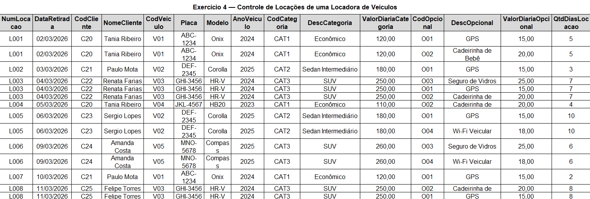
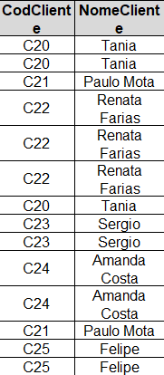
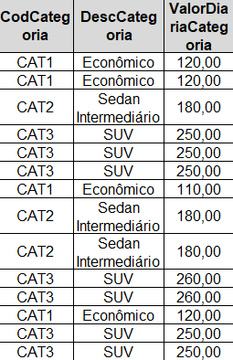
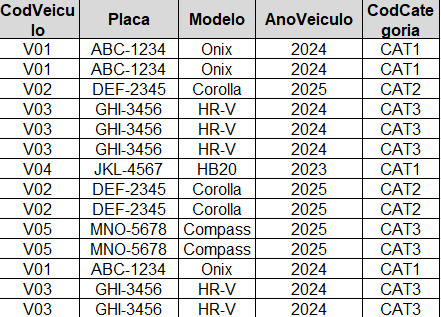
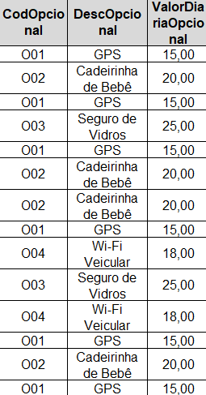
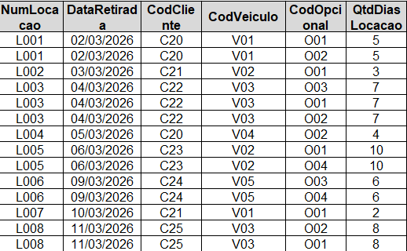

# Mini-Projeto: Sistema de Controle de Locações de Veículos

Este projeto demonstra o processo prático de análise, normalização de dados e criação do esquema físico de uma base de dados relacional a partir de uma tabela desnormalizada de controle de locações.

## O Desafio
A planilha original continha alta redundância de dados e dependências multivaloradas. O objetivo foi identificar os atributos multivalorados ou grupos repetitivos e aplicar os conceitos de normalização, criando os relacionamentos corretos.
* **Tabela Original:**


---

## Passo a Passo da Normalização e Implementação em SQL

### 1. Entidade Cliente (`cliente`)
Isolamos os dados cadastrais dos clientes para eliminar a repetição do nome a cada nova locação.
* **Tabela Normalizada:**


**Código SQL (DDL):**
```sql
CREATE TABLE cliente(
    cod_cliente VARCHAR(10) PRIMARY KEY,
    nome VARCHAR(80) NOT NULL
);
```

### 2. Entidade categoria (`categoria`)
Isolamos as categorias dos veículos e os respetivos valores das diárias.
* **Tabela Normalizada:**


**Código SQL (DDL):**
```sql
CREATE TABLE categoria(
    cod_categoria VARCHAR(10) PRIMARY KEY,
    desc_categoria VARCHAR(80) NOT NULL,
    valor FLOAT NOT NULL
);
```

### 3. Entidade veiculo (`veiculo`)
Regista a frota de veículos, ligando cada unidade à sua respetiva categoria através de uma chave estrangeira (relação 1:N).
* **Tabela Normalizada:**


**Código SQL (DDL):**
```sql
CREATE TABLE veiculo(
    cod_veiculo VARCHAR[10] PRIMARY KEY,
    placa VARCHAR(20) NOT NULL,
    modelo VARCHAR(40) NOT NULL,
    ano_veiculo YEAR NOT NULL,
    cod_categoria VARCHAR(10),

    CONSTRAINT fk_categoria FOREIGN KEY cod_categoria REFERENCES categoria(cod_categoria)
);
```

### 4. Entidade opcional (`opcional`)
Lista os opcionais disponíveis (como GPS, cadeirinha, etc.) e os respetivos custos diários.
* **Tabela Normalizada:**


**Código SQL (DDL):**
```sql
CREATE TABLE opcional(
    cod_opcional VARCHAR(10) PRIMARY KEY,
    desc_opcional VARCHAR(80) NOT NULL,
    valor_opcional FLOAT NOT NULL
);
```

### 5. Entidade locação (`locacao`)
Tabela principal (cabeçalho) que armazena os dados centrais de cada locação realizada por um cliente com um veículo específico.
* **Tabela Normalizada:**


**Código SQL (DDL):**
```sql
CREATE TABLE locacao(
    num_locacao VARCHAR(10) PRIMARY KEY,
    data_retirada DATE NOT NULL,
    cod_cliente VARCHAR(10) NOT NULL,
    cod_veiculo VARCHAR(10) NOT NULL,
    qtd_dias INT NOT NULL,

    CONSTRAINT fk_cliente FOREIGN KEY cod_cliente REFERENCES cliente(cod_cliente),
    CONSTRAINT fk_veiculo FOREIGN KEY cod_veiculo REFERENCES veiculo(cod_veiculo)
);
```

### 6. Tabela Associativa (`locacao_opcional`)
Como uma locação pode ter vários opcionais e um opcional pode estar presente em várias locações, criamos uma tabela associativa para resolver o relacionamento de Muitos para Muitos (M:N) utilizando uma chave primária composta.

**Código SQL (DDL):**
```sql
CREATE TABLE locacao_opcional(
    num_locacao VARCHAR(10) NOT NULL,
    cod_opcional VARCHAR(10) NOT NULL,

    CONSTRAINT pk_locacao_opcional PRIMARY KEY (num_locacao, cod_opcional),
    CONSTRAINT fk_opcional FOREIGN KEY cod_opcional REFERENCES opcional(cod_opcional),
    CONSTRAINT fk_locacao FOREIGN KEY num_locacao REFERENCES locacao(num_locacao)
);
```